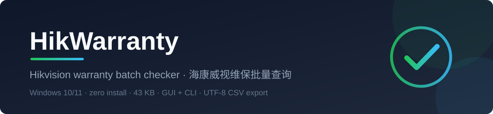
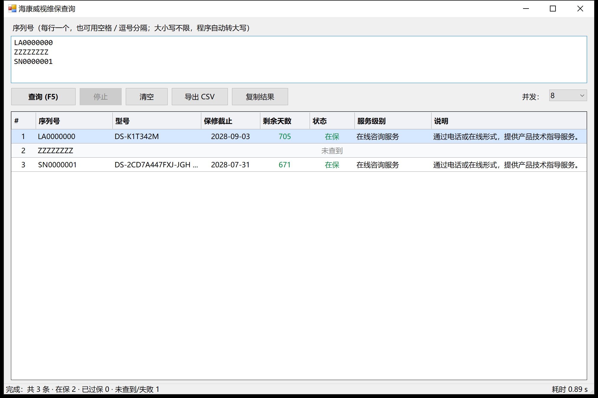

# HikWarranty

**Batch-query Hikvision device warranty status — from a tiny native Windows GUI or the command line. 43 KB, zero dependencies, no installer.**


-512BD4)




## Features

- **Batch input** — paste serial numbers (newline / space / comma separated); duplicates are removed and serials are upper-cased automatically (the official API is case-sensitive).
- **Real parallelism** — queries run concurrently (default 8, the measured sweet spot): 30 serials in **4.5–5.5 s** vs ~23 s serial.
- **Live results table** — color-coded status (in warranty / expired / not found), progress bar, elapsed time.
- **Detail view** — every field returned by the API, the raw JSON response, and one-click access to the product image.
- **Export** — CSV (UTF-8 with BOM, opens cleanly in Excel) or clipboard (TSV, paste straight into a spreadsheet).
- **Scriptable CLI** — text table, JSON output, CSV export, meaningful exit codes.
- **Zero installation** — a self-contained executable (no runtime download, no installer, no registry writes). Settings are stored in `%LOCALAPPDATA%\HikWarranty\ui.ini`.

## Screenshot



## Download

Grab the latest executables from **[Releases](../../releases)**:

| Asset | Purpose |
|---|---|
| `HikWarranty-v1.0.0-win64.exe` | Graphical interface (double-click to run) |
| `HikWarranty-CLI-v1.0.0-win64.exe` | Command-line version (`hikq`) |
| `checksums.txt` | SHA-256 checksums of the above |

**System requirements:** Windows 10/11 (x64). The .NET Framework 4.8 runtime is preinstalled on Windows 10 1903+ and Windows 11 — nothing else is needed.

> **Unsigned binary notice:** these executables are not code-signed, so Windows SmartScreen may show "Windows protected your PC / unknown publisher". This is normal for unsigned open-source builds — click **More info → Run anyway**.

## Usage

### GUI

1. Run `HikWarranty-v1.0.0-win64.exe`.
2. Paste serial numbers into the box (one per line, or separated by spaces/commas).
3. Press `Enter` (single line) or `F5` to query; `Stop` cancels.
4. Right-click a row for **details / open product image / copy**; double-click for the detail window.
5. Use **Export CSV** or **Copy results** to move data into Excel.

Shortcuts: drag a `.txt` file onto the input box to load it; `HikWarranty.exe sn1 sn2 …` queries on start; `HikWarranty.exe serials.txt` loads a file and queries.

### CLI

```
hikq.exe LA0000000                          # single serial
hikq.exe LA0000000 SN0000001 -c 8           # several serials
hikq.exe -f serials.txt -o result.csv       # batch from file, export CSV
hikq.exe -f serials.txt -j                  # JSON output (for scripts)
```

| Option | Description |
|---|---|
| `-f, --file <path>` | Read serials from a text file (one per line; spaces/commas also work) |
| `-o, --out <path>` | Write results to CSV (UTF-8 with BOM) |
| `-c, --concur <n>` | Concurrency (default 8) |
| `-j, --json` | Emit JSON instead of a table |
| `-h, --help` | Show help |

Exit codes: `0` — all queries succeeded; `1` — some serials were not found or failed; `2` — usage error.

## Build from source

**Requirement: Windows 10/11. Nothing else** — the project is compiled with the C# compiler that ships with the .NET Framework (`%WINDIR%\Microsoft.NET\Framework64\v4.0.30319\csc.exe`). No Visual Studio, no .NET SDK, no NuGet.

```powershell
powershell -ExecutionPolicy Bypass -File build.ps1
```

Outputs `dist\HikWarranty.exe` (GUI) and `dist\hikq.exe` (CLI).

| Path | Description |
|---|---|
| `src/Api.cs` | API client: query, JSON parsing, retry, batch scheduler |
| `src/Models.cs` | Data model + serial-number text parser |
| `src/Gui.cs` | WinForms interface (compiled to `HikWarranty.exe`) |
| `src/Cli.cs` | Command-line entry point (compiled to `hikq.exe`) |
| `app.manifest` | DPI awareness / execution-level manifest |
| `build.ps1` | Two-pass `csc` build script |

*Development notes (Chinese) — including the performance-tuning and DPI debugging story: [docs/技术博客.md](docs/技术博客.md).*

## How it works

The tool is a thin client for the official Hikvision partner portal endpoint:

```
POST https://partners.hikvision.com/support/psp-api/repair/csp/product/getSnWarrantyInfo
Content-Type: application/json
{"serialNumber":"LA0000000"}
```

- The endpoint is public and works anonymously (no login, no cookies).
- The response header carries **no charset**, so the client reads the body as bytes and decodes UTF-8 explicitly.
- On startup the client warms up the TLS connection and raises .NET's per-host connection limit (default **2**) to 64 — without that, batch parallelism is silently throttled.
- Please keep concurrency moderate; the default of 8 is deliberately chosen to stay friendly to the official server.

## FAQ

**Is a login required?** No. The query endpoint is public; the tool never authenticates or stores credentials.

**Why did my serial come back "not found"?** Make sure the case is right — the API is case-sensitive (`la0000000` fails, `LA0000000` works). The app upper-cases input automatically, but serials must be genuine device serials.

**Antivirus / SmartScreen warnings?** Unsigned binaries trigger SmartScreen heuristics. Verify the SHA-256 in `checksums.txt` if you want certainty.

**Can I raise the concurrency?** Yes (`-c 16`), but measurements show 16 is *slower* than 8 — the server starts queueing.

**What if the API changes?** Edit `src/Api.cs` (URL, fields) and rebuild — the build takes seconds.

**Where are my settings?** `%LOCALAPPDATA%\HikWarranty\ui.ini` (window size, concurrency). Delete it to reset.

## License

[MIT](LICENSE) © 2026 szrd2026

---

## 中文说明

**HikWarranty —— 海康威视维保批量查询工具（Windows 原生，43 KB，免安装）。**

### 功能

- **批量查询**：粘贴序列号（每行一个，空格/逗号分隔均可），自动去重、自动转大写（官方接口区分大小写）
- **真并发**：默认并发 8（实测最优），30 条查询 **4.5~5.5 秒**（串行约 23 秒）
- **结果表格**：在保 / 已过保 / 未查到 三色标识，实时进度与耗时
- **详情窗口**：完整字段 + 原始 JSON + 一键打开产品图片
- **导出**：CSV（UTF-8 带 BOM，Excel 直接打开）或复制到剪贴板（可直接粘贴 Excel）
- **命令行版**：`hikq.exe` 支持表格/JSON/CSV 输出与退出码，方便脚本与批处理
- **零安装**：单文件 exe，无需安装任何运行时（Win10 1903+ / Win11 自带 .NET Framework 4.8）

### 下载与使用

在 [Releases](../../releases) 下载 `HikWarranty-v1.0.0-win64.exe`（图形界面）或 `HikWarranty-CLI-v1.0.0-win64.exe`（命令行），双击/命令行运行即可，无需安装。

- 界面：粘贴序列号 → `Enter` 或 `F5` 查询 → 右键查看详情/打开图片 → 导出 CSV
- 命令行示例：`hikq.exe LA0000000 SN0000001 -c 8`、`hikq.exe -f 序列号.txt -o 结果.csv`
- 未签名的 exe 首次运行可能被 SmartScreen 提示"未知发布者"，属正常现象，点「更多信息 → 仍要运行」即可；可用 `checksums.txt` 校验 SHA-256

### 从源码构建

只需要 Windows 10/11（使用系统自带 C# 编译器，无需 Visual Studio / .NET SDK）：

```powershell
powershell -ExecutionPolicy Bypass -File build.ps1
```

### 注意事项

- 接口为官方公开接口，无需登录；请保持温和的请求频率（默认并发 8 已实测对服务器友好），勿用于高频抓取
- 结果仅供参考，正式业务请以官方平台页面为准
- 接口如有调整，修改 `src/Api.cs` 后重新编译即可

详细开发过程（性能调优、DPI 调试实录）见 [技术博客](docs/技术博客.md)。